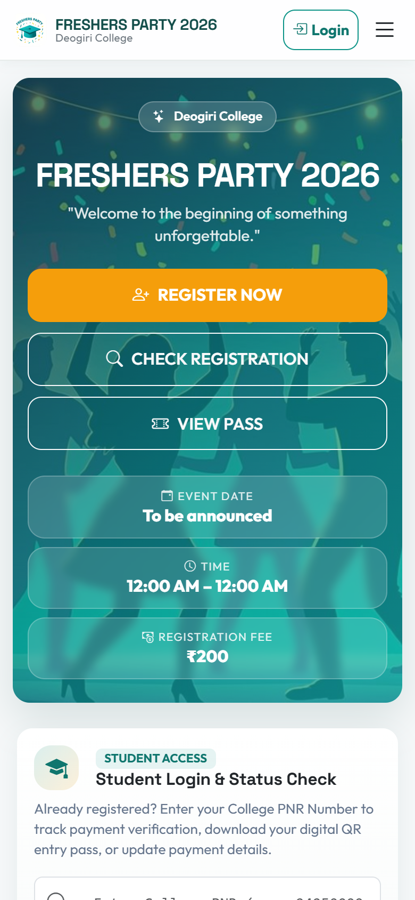
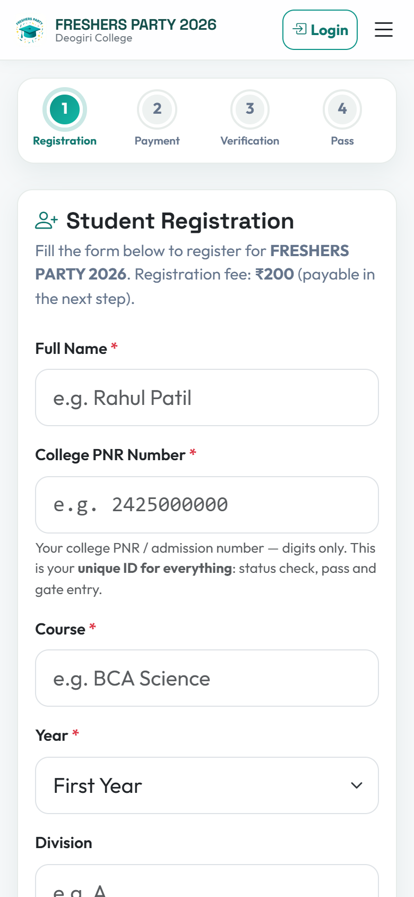
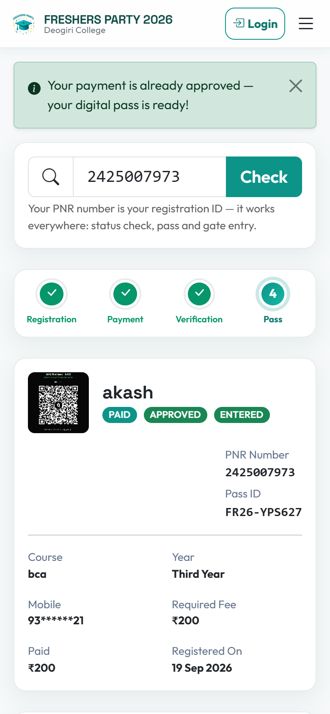
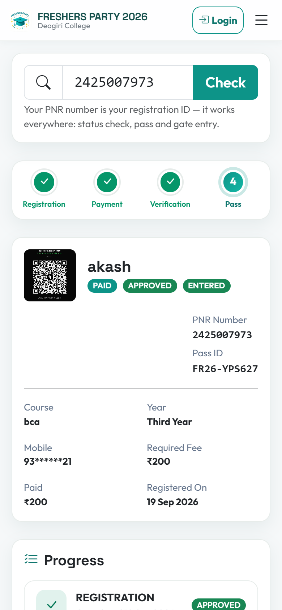
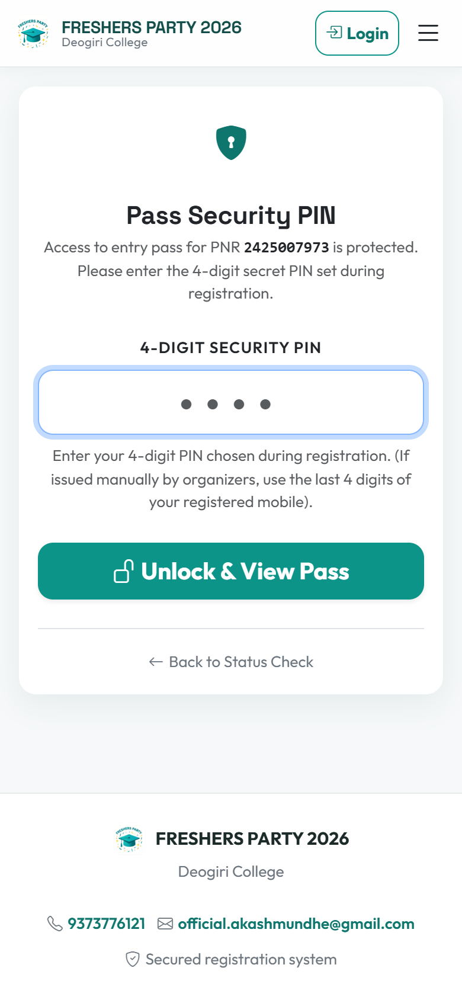
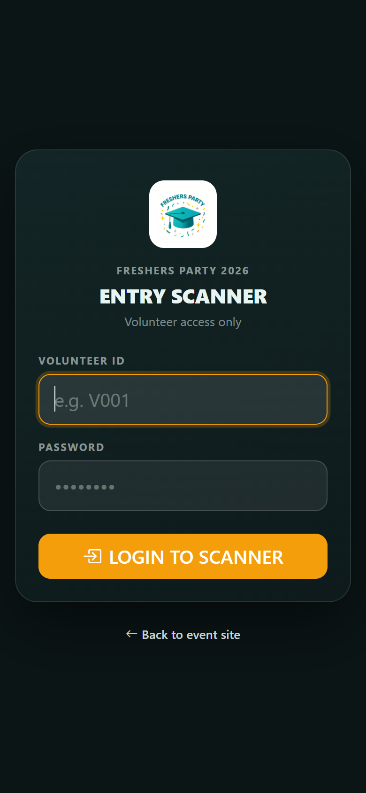
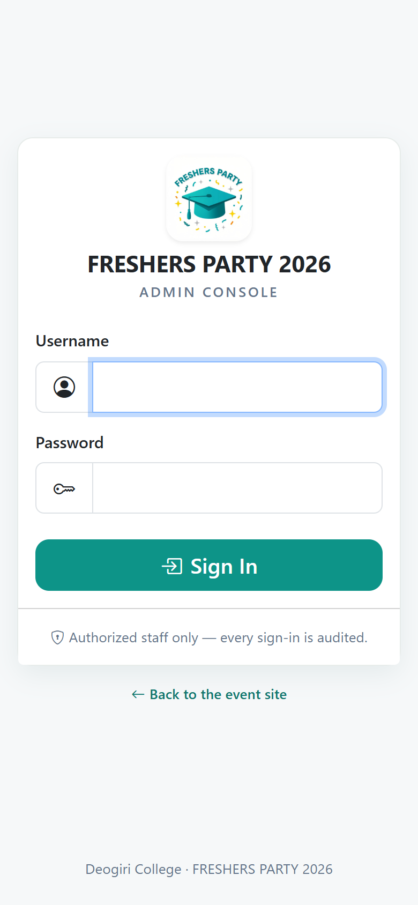
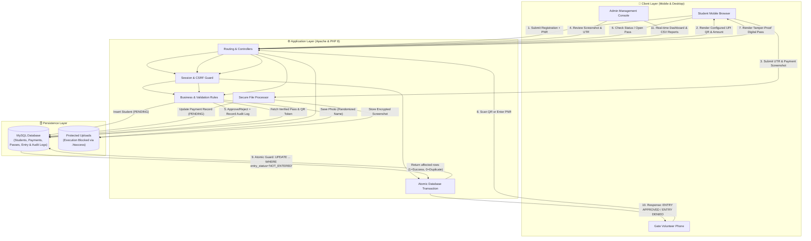
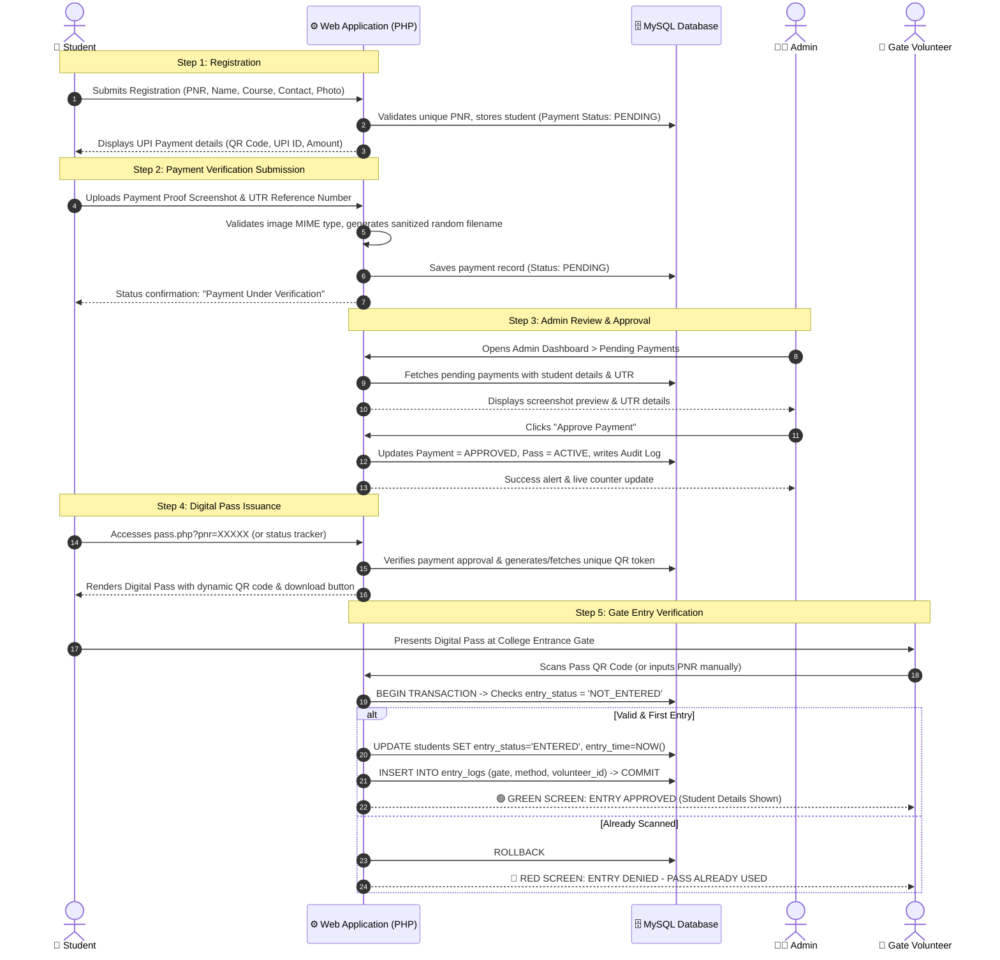

# 🎟️ FRESHERS PARTY 2026 — Event Management System

<div align="center">


**A complete, secure, mobile-first Event Management & Entry Verification Web Application for College Fresher Parties, Festivals, and Cultural Events.**

[📱 Mobile UI Showcase](#-mobile-ui-screenshots) • [🔄 Data Flow Diagram](#-system-architecture--data-flow) • [🚀 Start-to-End Process](#-start-to-end-process-explanation) • [⚙️ Installation Guide](#️-installation--setup-guide) • [📤 GitHub Upload](#-github-upload-instructions)

</div>

---

## 📌 Executive Summary

The **Fresher Party Event Management System** is a production-ready PHP 8 + MySQL web platform engineered specifically for college events, fresher celebrations, and annual fests. Built with a **mobile-first design** (tested on Android Chrome and iOS Safari), it solves the core bottlenecks of college event organization:
1. **Student Registration** using the **College PNR / Roll Number** as a universal unique identifier.
2. **UPI Payment Collection & Verification** with dynamic QR codes, UTR submission, and screenshot validation.
3. **Tamper-Proof Digital Passes** featuring cryptographically secure single-use QR codes.
4. **Gate Entry Scanning & Atomic Concurrency Guard** ensuring that passes cannot be reused or double-scanned across multiple gates simultaneously.
5. **Role-Based Admin Console** with live real-time check-in stats, manual registration, special pass tiers, and CSV report export.

> ### 🎫 The College PNR Number is the Universal Identifier
> Every student registers with their official **college PNR / admission number** (digits only, e.g. `2425000000`).
> - **Students** check status and retrieve their digital pass anytime using their PNR (`status.php?pnr=…`, `pass.php?pnr=…`).
> - **Admins** filter, search, verify payments, and export CSV reports keyed by PNR.
> - **Gate Volunteers** can manually admit students via PNR if the phone battery dies or the screen is cracked—triggering the exact same atomic validation check.

---

## 📱 Mobile UI Screenshots

The entire application is optimized for mobile screens. Below are high-resolution screenshots from key touchpoints of the user journey:

| 1. Homepage & Countdown | 2. Student Registration |
|:---:|:---:|
|  |  |
| *Event details, rules, live countdown timer, and quick links.* | *Clean form with PNR validation, course/year selection & photo upload.* |

| 3. UPI Payment & Proof Upload | 4. Real-time Status Tracker |
|:---:|:---:|
|  |  |
| *Displays UPI QR, copyable UPI ID, UTR input, and receipt upload.* | *Live status banner: Pending Review, Approved, or Rejected.* |

| 5. Digital QR Pass | 6. Gate Volunteer Scanner |
|:---:|:---:|
|  |  |
| *Secure QR code, student photo, pass ID, print & download buttons.* | *Camera QR scanner with audio/vibration feedback & manual PNR fallback.* |

| 7. Admin Console Login |
|:---:|
|  |
| *Secure role-based dashboard authentication with CSRF protection.* |

---

## 🔄 System Architecture & Data Flow

The client browser never decides whether a payment is approved or an entry is valid. Every state transition is guarded server-side and recorded in MySQL.

### Data Flow Diagram



### End-to-End Sequence Diagram



---

## 🚀 Start-to-End Process Explanation

### Step 1: Student Registration (`register.php`)
- The student opens the registration portal on their mobile device.
- Fills in their **College PNR Number** (10–15 digits), full name, branch/course, year, division, WhatsApp number, and optional passport photo.
- The server validates input formats, ensures the PNR is not already registered, creates the participant record with status `PENDING`, and redirects to the payment page.

### Step 2: UPI Payment & Proof Submission (`payment.php`)
- Displays the organizer's configured UPI QR code, UPI ID, payable amount, and direct UPI intent deep links (GPay, PhonePe, Paytm).
- After making the payment via their preferred UPI app, the student enters the **12-digit UTR / Transaction Reference Number** and uploads the payment confirmation screenshot.
- Files are verified using MIME sniffing, renamed to cryptographically random filenames, and saved in `uploads/payments/`.

### Step 3: Admin Review & Verification (`admin/payments.php`)
- The payment administrator views the pending payment queue.
- Checks the student's name, PNR, transaction UTR number, and full-resolution screenshot proof.
- **Approve:** With one click, the pass is generated, payment status is set to `APPROVED`, and pass status changes to `ACTIVE`.
- **Reject:** If fraudulent or mismatching, admin rejects with a mandatory reason (e.g., "Invalid UTR", "Amount mismatch"). The student sees the rejection reason on their tracker and can resubmit proof.

### Step 4: Pass Generation & Retrieval (`pass.php`, `status.php`)
- Students can check their status at any time by entering their PNR.
- Once approved, the student unlocks their **Digital Pass**.
- The pass includes:
  - Official College & Event branding
  - Student photo, name, branch, division, and unique Pass ID (`FR26-XXXXXX`)
  - Unique high-resolution QR code containing a secure 128-bit randomized token (`qr_token`)
  - One-tap buttons to download the pass as an image or print to PDF.

### Step 5: Gate Entry Verification (`scanner/index.php`)
- Gate volunteers log in with their assigned gate credentials (e.g., `Gate 1`, `Gate 2`, `VIP Gate`).
- The volunteer taps **START SCANNER** to launch the camera and scans the student's QR code.
- **Instant Result:**
  - 🟢 **ENTRY APPROVED (Green Screen):** Shows student name, PNR, pass type, gate name, and plays a success chime.
  - 🔴 **ENTRY DENIED (Red Screen):** If scanned twice, displays "PASS ALREADY USED" with the exact gate and timestamp of the first entry!
- **Emergency Fallback:** If a student's phone battery dies or the screen is broken, the volunteer types their **PNR Number** into the manual input box. The server executes the exact same atomic validation.

---

## 🛡️ Security & Anti-Fraud Features

- **Atomic Concurrency Guard:** Pass redemption executes inside a guarded database transaction (`UPDATE students SET entry_status='ENTERED' WHERE id=? AND entry_status='NOT_ENTERED'`). Two gates scanning the exact same pass at the exact same millisecond will produce exactly one success and one rejection.
- **PDO Prepared Statements:** 100% of SQL queries use parameterized PDO prepared statements, eliminating SQL Injection vulnerabilities.
- **CSRF Token Protection:** Every form, modal, and background AJAX request carries a cryptographically validated per-session CSRF token.
- **Upload Hardening:** Uploaded files undergo MIME-type sniffing via `finfo` and `getimagesize()`. File extension whitelisting and 4 MB limits are enforced. The `.htaccess` file blocks execution of any PHP or CGI script inside `/uploads/`.
- **Private QR Payload:** The QR code contains only a random 128-bit hex token (`random_bytes(16)`). No student names, PNRs, or phone numbers are exposed in the QR code payload.
- **Complete Audit Trail:** Every sensitive mutation (approving payments, resetting entries, editing user details, modifying settings) is logged in `audit_logs` with admin username, role, old/new values, IP address, and timestamp.

---

## 👥 Role-Based Access Control (RBAC)

| Capability | SUPER_ADMIN | EVENT_ADMIN | PAYMENT_ADMIN | ENTRY_MANAGER |
|---|:---:|:---:|:---:|:---:|
| Live Dashboard & Statistics | ✅ | ✅ | ✅ | ✅ |
| View Participants | ✅ | ✅ | ✅ | ✅ |
| Create / Edit / Delete Participants | ✅ | ✅ | ❌ | ❌ |
| Verify Payments (Approve/Reject) | ✅ | ❌ | ✅ | ❌ |
| Issue / Manage Special Passes | ✅ | ✅ | ❌ | ❌ |
| Live Entry Monitoring | ✅ | ✅ | ❌ | ✅ |
| Manual Gate Entry & Entry Reset | ✅ | ❌ | ❌ | ✅ |
| Manage Gate Volunteers | ✅ | ❌ | ❌ | ❌ |
| Event Settings & QR Configuration | ✅ | ✅ | ❌ | ❌ |
| System Audit Logs | ✅ | ❌ | ❌ | ❌ |
| CSV Report Exports | All Reports | All Reports | Payment CSV | Entry CSV |

---

## 📂 Project Directory Structure

```text
fresher-party/
│
├── index.php                 # Mobile-first Event Homepage & countdown
├── register.php              # Student registration form (PNR-keyed)
├── payment.php               # Payment instructions & UPI QR display
├── payment-submit.php        # UTR & payment screenshot submission handler
├── status.php                # Live registration & payment status tracker
├── pass.php                  # Tamper-proof digital QR pass view
├── install.php               # First-time web installer & DB setup wizard
├── logout.php                # Session termination
├── error.php                 # Generic error display
├── database.sql              # Clean database schema for fresh installations
├── DEPLOYMENT.md             # Production deployment & hosting guide
├── .gitignore                # Git exclusion rules for secrets & uploads
├── .htaccess                 # Security rules, URL routing & upload protection
│
├── admin/                    # Admin Management Console
│   ├── index.php / login.php # Admin dashboard & authentication
│   ├── registrations.php     # Participant listing & PNR search
│   ├── payments.php          # Pending payment verification queue
│   ├── entries.php           # Real-time gate entry logs & lists
│   ├── manual-entry.php      # Emergency manual gate entry
│   ├── passes.php            # Pass status & special pass generation
│   ├── volunteers.php        # Gate volunteer account management
│   ├── settings.php          # Event branding, fee, & UPI QR config
│   ├── reports.php           # CSV data export generator
│   └── audit-logs.php        # Security audit log viewer
│
├── scanner/                  # Gate Volunteer Scanner Portal
│   ├── index.php             # HTML5 QR code camera scanner
│   ├── login.php             # Volunteer gate login
│   └── scan.php              # Server-side scan verification endpoint
│
├── api/                      # AJAX & API Endpoints
│   ├── verify-pass.php       # Pass validation API
│   ├── dashboard-stats.php   # Auto-refreshing statistics endpoint
│   └── search-participant.php# Instant participant lookup
│
├── config/                   # Configuration & Database Connection
│   ├── config.php            # App constants & environment loader
│   ├── database.php          # PDO connection singleton
│   └── secrets.example.php   # Template for local credentials
│
├── includes/                 # Reusable Business Logic & Partials
│   ├── functions.php         # Core utility functions & sanitize helpers
│   ├── auth.php              # User authentication helpers
│   ├── csrf.php              # CSRF generation and validation
│   ├── header.php            # Public site header
│   └── footer.php            # Public site footer
│
├── assets/                   # Static Frontend Assets
│   ├── css/style.css         # Custom responsive stylesheet
│   ├── js/app.js             # Client scripts & interaction logic
│   ├── js/scanner.js         # Camera scanner handler
│   └── images/               # Default logos and artwork
│
├── docs/                     # Documentation & Media Assets
│   ├── data-flow.md          # Comprehensive data flow & architecture doc
│   └── screenshots/          # Mobile UI screenshots for GitHub preview
│
└── uploads/                  # User Generated Files (.htaccess protected)
    ├── students/             # Student profile photos
    ├── payments/             # Uploaded payment verification screenshots
    └── event/                # Custom event banners & QR codes
```

---

## ⚙️ Installation & Setup Guide

### Method A: Local Setup with XAMPP (Windows / macOS / Linux)

1. **Clone or Copy the Project:**
   Place the project inside your web server's root folder:
   - For XAMPP Windows: `C:\xampp\htdocs\fresher-party\`
   - For XAMPP Mac: `/Applications/XAMPP/htdocs/fresher-party/`
   - For Linux: `/var/www/html/fresher-party/`

2. **Start Apache & MySQL:**
   Open the XAMPP Control Panel and start both **Apache** and **MySQL**.

3. **Database Configuration:**
   - Open **phpMyAdmin** (`http://localhost/phpmyadmin/`).
   - Create a new database named `fresher_party`.
   - Click the **Import** tab, choose [database.sql](database.sql), and click **Import**.
   - *(Optional)* If you use custom database credentials, copy `config/secrets.example.php` to `config/secrets.php` and configure them. By default on localhost, it automatically connects with `root` and an empty password.

4. **Launch Application:**
   Open your browser and navigate to:
   - **Public Site:** `http://localhost/fresher-party/`
   - **Admin Portal:** `http://localhost/fresher-party/admin/login.php`
   - **Gate Scanner:** `http://localhost/fresher-party/scanner/login.php`

---

### Method B: Hosting Setup (InfinityFree / cPanel / Shared Hosting)

1. **Upload Files:** Upload the repository files to your `htdocs/` or `public_html/` folder using FTP (FileZilla) or File Manager.
2. **Create MySQL Database:** From your hosting control panel, create a MySQL database and user. Note down the Hostname, Database Name, Username, and Password.
3. **Configure Secrets:** Create `config/secrets.php` on the server and insert your database credentials:
   ```php
   <?php
   return [
       'DB_HOST' => 'sqlXXX.yourhost.com',
       'DB_NAME' => 'your_db_name',
       'DB_USER' => 'your_db_user',
       'DB_PASS' => 'your_strong_password',
   ];
   ```
4. **Run Web Installer:** Visit `https://yourdomain.com/fresher-party/install.php` to automatically create tables, configure directories, and set up your Super Admin account.
5. **Security Finalization:** Delete or rename `install.php` after installation is complete.

---

## 📤 GitHub Upload Instructions

The repository is already configured with a production-grade `.gitignore` that prevents sensitive local secrets, real payment screenshots, and database dumps from being uploaded.

To push this repository to GitHub:

```powershell
# 1. Open PowerShell and navigate to the project directory
cd C:\xampp\htdocs\fresher-party

# 2. Stage all project files (safe files only; uploads and secrets are auto-ignored)
git add .

# 3. Create your initial commit
git commit -m "feat: complete event management system with mobile UI, QR pass, and data flow docs"

# 4. Ensure you are on the main branch
git branch -M main

# 5. Remote is already configured to:
# https://github.com/Silent0sky/Event_managment_system.git
# (Verify with: git remote -v)

# 6. Push to GitHub
git push -u origin main
```

---

## 📄 License & Attribution

This project is open-source under the [MIT License](LICENSE).  
Developed for college event committees and student organizers to deliver a seamless, professional, and secure event check-in experience.
