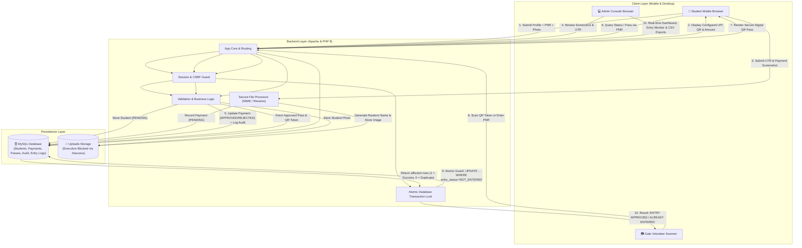
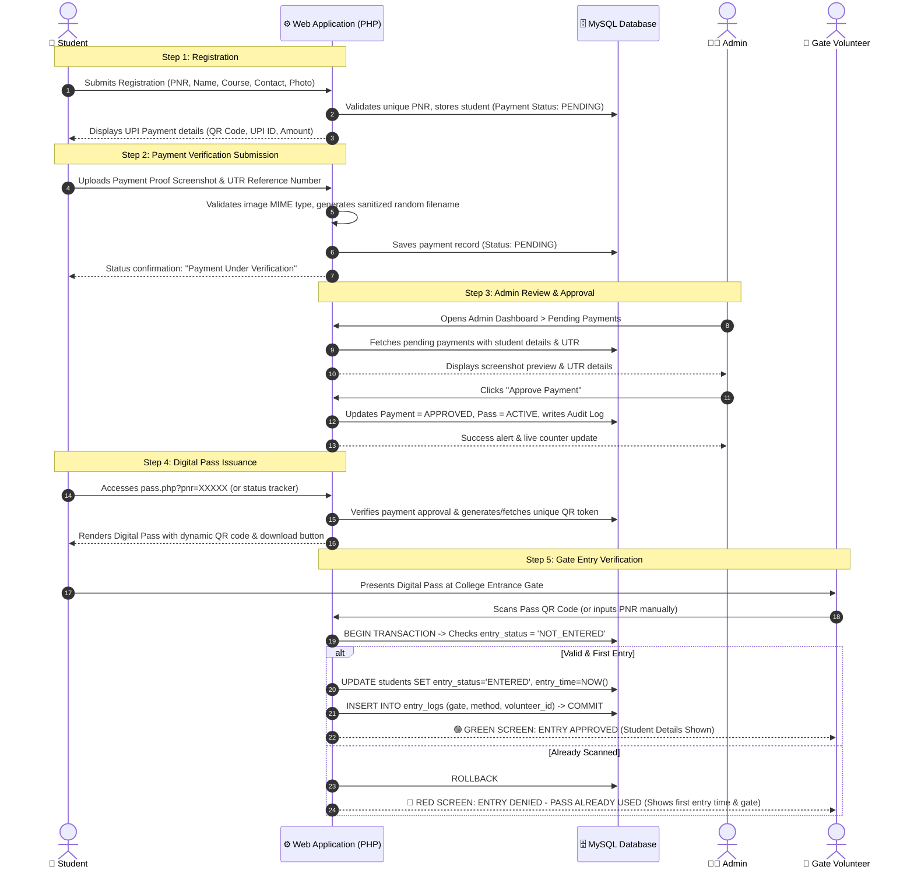
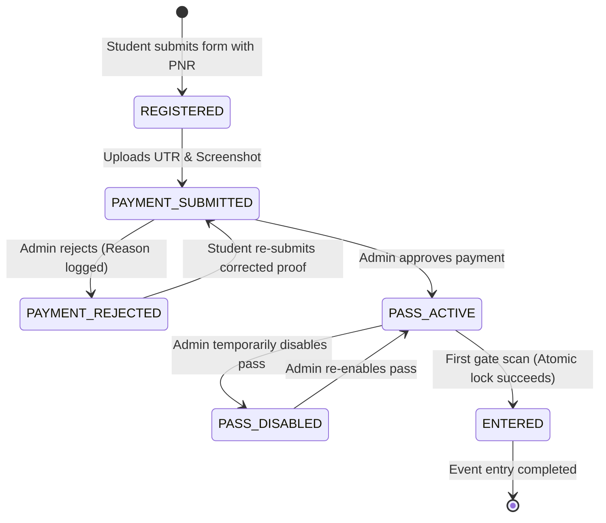

# Fresher Party 2026 — Data Flow & Architecture Documentation

This document describes the end-to-end data flow, system architecture, security boundaries, and lifecycle states for the Fresher Party Event Management System.

---

## 1. High-Level Data Flow Diagram

The browser never decides whether a payment is approved or an entry is valid. Every state transition is verified server-side with atomic locks in MySQL.

---

## 2. End-to-End Sequence Diagram

This sequence diagram illustrates the chronological steps from the student's initial registration through to the final gate entry verification.

---

## 3. Student & Pass Lifecycle State Machine

---

## 4. Security & Data Boundaries

| Boundary | Storage / Target | Security Enforcements |
|---|---|---|
| **Student Credentials & Identity** | MySQL (`students` table) | The College PNR is the universal identifier. Validated with strict regular expressions (`^[0-9]{10,15}$`) to prevent injection. |
| **Pass Tokens** | MySQL (`students.qr_token`) | Cryptographically secure 128-bit random tokens (`random_bytes(16)`). The QR code holds only this opaque token; no personal student data is leaked into the QR payload. |
| **Payment & Profile Uploads** | File System (`/uploads/`) | Files are validated by MIME sniffing (`finfo`), size capped (4 MB), assigned pseudo-random UUID filenames, and executed-script protection is enforced by `.htaccess` (`SetHandler default-handler`, `php_flag engine off`). |
| **Admin & Volunteer Authentication** | Session (`$_SESSION['FPSESS']`) | Bcrypt (`password_hash`), CSRF token verification per request, session hijacking protection (`SameSite=Lax`, `HttpOnly`, User-Agent validation). |
| **Gate Entry Concurrency** | MySQL Row-Level Transaction | Guaranteed single entry under high concurrency using atomic SQL queries (`UPDATE students SET entry_status='ENTERED' WHERE id=? AND entry_status='NOT_ENTERED'`). Simultaneous gate scans cannot produce duplicate entries. |
